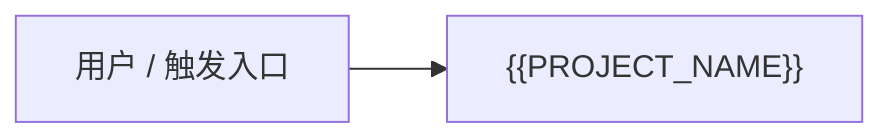

# {{PROJECT_NAME}} 项目架构

> 本文件跨阶段持续维护，记录当前生效的系统架构、模块代码边界与公共契约。详细阶段任务见 `docs/workflow/current.md` 指向的当前阶段目录。

## 1. 系统目标、设计原则与变更背景

- **服务对象与核心结果：** 请替换为系统为谁服务、解决什么问题、交付什么核心体验。
- **核心设计原则：** 请替换为 2–4 条通俗直白的分工原则（例如：哪些计算由确定性代码负责、哪些判断交给模型、哪些边界绝不越过）。
- **明确不覆盖的范围：** 请替换为系统边界外的职责。

## 2. 技术选型与取舍理由

| 领域 | 当前方案 | 为什么选它（以及放弃了什么备选方案） |
| --- | --- | --- |
| 请替换为 | 请替换为 | 请替换为实际权衡理由，便于后续维护者理解。 |

## 3. 端到端流程与数据流

### 3.1 主流程分步说明

1. 请替换为从入口触发到最终输出的分步数据流（可标注关键模块的预期耗时或数据体量）。

### 3.2 失败、重试与并发规则

- 请替换为明确的超限、超时、重试上限、降级兜底与并发隔离规则。

## 4. 模块划分与代码定位

| 模块 | 实际代码路径 | 负责什么 | 严禁越界负责什么 |
| --- | --- | --- | --- |
| 请替换为 | `src/...` | 请替换为职责描述 | 请替换为明确禁止承担的职责 |

## 5. 核心数据模型与必须守住的规则

| 实体 / 表 / 对象 | 关键字段 | 生命周期与必须始终成立的规则 |
| --- | --- | --- |
| 请替换为 | 请替换为 | 请替换为约束、状态流转与不可破坏的不变量 |

## 6. 对外与模块间接口约定

### 6.1 公共约定

- 请替换为版本标识、鉴权方式、序列化格式、错误分类与幂等要求。

### 6.2 核心接口清单

| 接口 / 事件 / 命令 | 调用权限 | 输入与输出约定 |
| --- | --- | --- |
| 请替换为 | 请替换为 | 请替换为请求结构、正常返回与典型错误 |

## 7. 安全、隐私与外部资源边界

- 请替换为信任边界、凭证加密与脱敏规则、私人数据隔离，以及外部付费/发布操作的授权红线。

## 8. 运行、部署与验证基线

- 请替换为运行拓扑、关键环境变量、持久化与日志说明，以及各类自动化测试与替身（mock）的适用边界。
